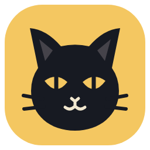
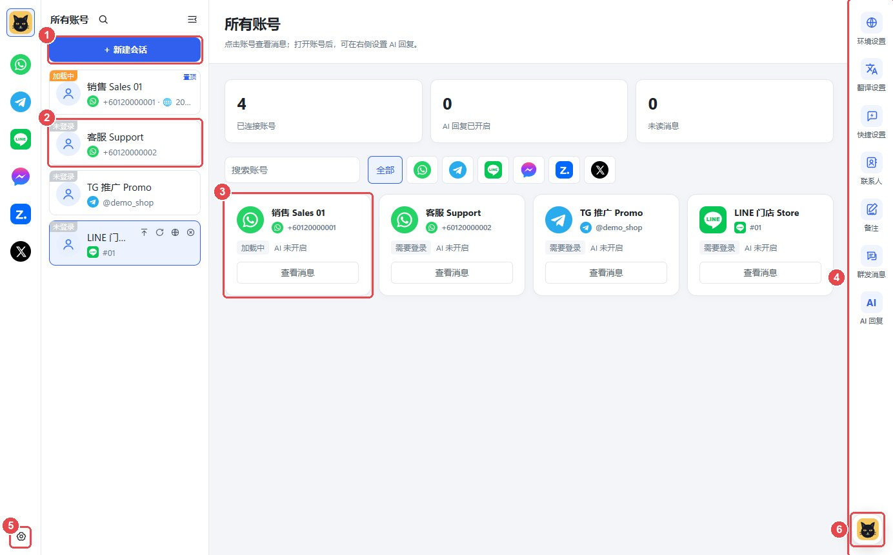

<p align="center"></p>

<h1 align="center">黑猫SCRM</h1>

<p align="center">多平台聊天与客户管理 · Multi-account customer chat for WhatsApp, Telegram, LINE and Facebook</p>

<p align="center"></p>

黑猫SCRM is a Windows desktop app for teams that serve customers on many messaging accounts at once. Every account runs in its own isolated session inside one window, with AI and sales tools built around the chats.

黑猫SCRM 是一个 Windows 桌面软件：在一个窗口里同时登录、管理多个 WhatsApp、Telegram、LINE、Facebook 账号，每个账号互相隔离，并提供 AI 与销售工具。

## Features · 功能

- **Many accounts, one window**: per-account sessions, proxy and environment settings, unread counts and desktop notifications.
- **AI auto-replies** (Claude): replies from your own knowledge base, with hand-off to a human when needed.
- **Translation**: incoming and outgoing messages, per account or per customer.
- **黑猫助手 (assistant)**: answers questions about the app, changes settings, reads a chat (including photos and group senders) and suggests replies you can fill into the typing box.
- **Bulk messaging**: recipient lists from recent chats or Excel, message templates and task tracking.
- **Contacts, quick replies and conversation notes.**
- **Local chat backup**: hourly archive of chats and media to a folder you choose, with a built-in viewer.
- **Plans and AI points**: customers log in to a license server; AI requests go through it, so they don't need their own Claude key.
- **Automatic updates**: new versions download in the background; forced updates are supported.

## Project layout · 目录

| Path | What it is |
| --- | --- |
| `main.js`, `preload.js` | Electron main process and the bridge to the window |
| `renderer/` | The app window (HTML, CSS, JS) |
| `webview-preload.js` | Runs inside each chat page: reads chats, sends messages, backup capture |
| `assistant-*.js`, `renderer/assistant*.js` | 黑猫助手 |
| `ai-*.js`, `knowledge-*.js`, `translate.js` | AI replies, knowledge base and translation |
| `backup-*.js` | Local chat backup and viewer |
| `license.js`, `app-update.js` | Customer login and automatic updates |
| `server/` | License server: logins, plans, points, Claude relay, admin page, update hosting ([server/README.md](server/README.md)) |
| `scripts/`, `推送更新.bat` | Build the user guide; one-click "build and publish an update" |

## Development · 开发

Requires Windows, Node.js 22.13+.

```bash
npm install
npm start          # run the app from source
npm run dist       # build the installer into dist/
```

To publish an update to customers, double-click `推送更新.bat`: it raises the version, builds the installer and publishes it on the license server. See [server/README.md](server/README.md) for running the server.

## License

Copyright © 黑猫SCRM. All rights reserved. The source is public to read; it is not open source, and no permission is granted to copy, modify or redistribute it.
