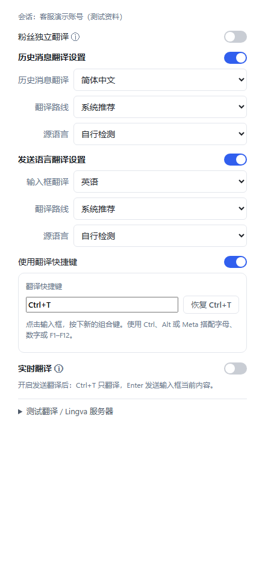

# WhatsApp 客服翻译：先检查译文，再按 Enter 发送

*图 1：多账号工作台与翻译入口，使用演示资料展示。*

## 摘要

把客户回复翻译好，再确认发出去，是跨语言客服值得保留的一步。本文介绍黑猫 SCRM 的翻译快捷键设置，以及发送前应核对的三类信息，适合外贸、电商和多语言客服团队参考。

## 跨语言回复，需要给核对留一步

客户用英文询问交期，客服先用中文组织回复，再转换成客户熟悉的语言。这类沟通里，语句通顺只是基础，数量、时间和承诺范围也需要准确。

例如，“周五前发货”和“周五前送达”涉及不同的安排。即使一句译文读起来很自然，客服仍应确认它表达的是自己能够承诺的内容。

把“翻译”和“发送”分开，可以给这次检查留出明确的位置：先得到译文，核对必要信息，再决定发送。检查应放在发送前的固定步骤里。

## 在黑猫 SCRM 中设置翻译快捷键

黑猫 SCRM 提供可选择的翻译快捷键模式，默认没有开启。使用时，可以按以下顺序设置：[快捷键设置依据](https://github.com/yaphetsky7/Blackcat-SCRM/blob/main/renderer/app.js)。

1. 在左侧选择需要使用的 WhatsApp 账号，打开右侧「翻译设置」。
2. 开启「发送语言翻译设置」，选择目标语言、源语言和翻译路线。
3. 勾选「使用翻译快捷键」，默认组合键为 **Ctrl+T**。
4. 在聊天输入框写好原文，按快捷键，将译文放入输入框。
5. 检查译文，按需要修改，然后按 **Enter** 发送当前内容。

*图 2：当前翻译设置界面。开启快捷键后，可先翻译，再确认发送；截图使用测试资料。*

需要换键时，点击快捷键输入框，再按下新的组合键即可。该设置按账号保存，切换到其他账号后应检查对应设置。

**注意：快捷键模式下，Enter 发送的是输入框当前内容。** 如果还没有执行翻译，里面可能仍是原文。关闭快捷键选项后，若发送翻译保持开启，Enter 则沿用翻译并发送的流程。这两种模式应在团队内约定清楚。[发送行为依据](https://github.com/yaphetsky7/Blackcat-SCRM/blob/main/webview-preload.js)

## 发出前重点检查三类信息

检查时，可以先对照原文中的业务信息，再检查译文是否容易理解。

| 检查项目 | 核对重点 |
| --- | --- |
| 数量、单位和币种 | 件数、尺寸、金额、小数点，以及货币名称是否清楚。 |
| 时间和适用条件 | 日期、时区、发货与到货的区别，是否需要先确认库存。 |
| 商品与服务范围 | 型号、套餐内容、是否包含运费，以及例外条件是否保留。 |

碰到术语时，尽量写清楚完整名称。发现原文本身含糊，也应先补充信息，再重新翻译；只修改译文语气，未必能解决事实不清的问题。

较长的回复可以拆成几个短段落，每段说明一件事。客户阅读方便，客服也更容易逐项核对。

## 同一账号面对不同语言的客户，怎样设置？

一个账号可能同时接待英语、中文或马来语客户。黑猫 SCRM 支持账号默认翻译设置，也支持为客户设置独立语言。[功能说明](https://github.com/yaphetsky7/Blackcat-SCRM/blob/main/README.md)

可以先设定团队常用的默认语言；遇到需要其他语言的客户，再开启「粉丝独立翻译」，打开相应对话后设置。调整前先看清面板上的账号、联系人和设置范围，避免把单个客户的偏好误改成默认设置。

语言偏好也适合写进客户备注，便于接手的同事理解沟通习惯。记录客户明确表达的偏好即可，不必根据姓名或地区猜测。

## 从自己的测试对话开始

正式用于客户沟通前，建议先在自己的测试对话里试三句：普通问候、带数量或金额的回复，以及包含交期条件的回复。逐次检查快捷键是否只翻译、Enter 是否发送了预期内容。

如果译文没有成功放入输入框，先确认界面提示和当前文字，再继续操作。确认自己的常用语言、翻译路线和快捷键能够配合工作后，再把这套流程交给团队使用。

对需要多语言沟通的团队来说，一个可执行的起点就是：写清原文，核对译文中的关键信息，再确认发送。黑猫 SCRM 的翻译快捷键，可以作为落实这套流程的一个工具。

## 资料来源

- [黑猫 SCRM 项目功能介绍](https://github.com/yaphetsky7/Blackcat-SCRM/blob/main/README.md)
- [翻译设置与账号配置](https://github.com/yaphetsky7/Blackcat-SCRM/blob/main/renderer/app.js)
- [输入框翻译与发送处理](https://github.com/yaphetsky7/Blackcat-SCRM/blob/main/webview-preload.js)

*核对日期：2026 年 10 月 31 日。本稿依据当日本地 1.14.8 版源码及项目公开资料撰写；页面名称和行为可能随后续版本调整。*
